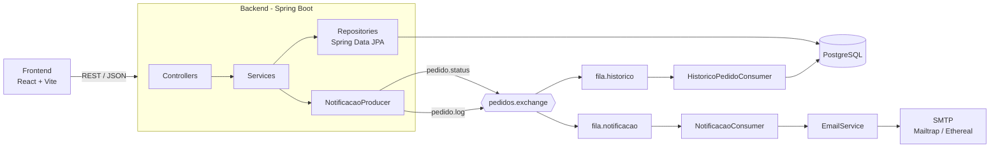
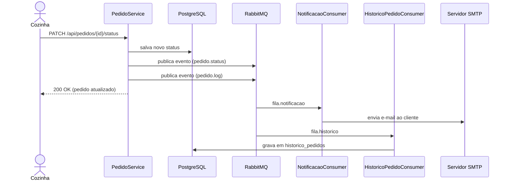
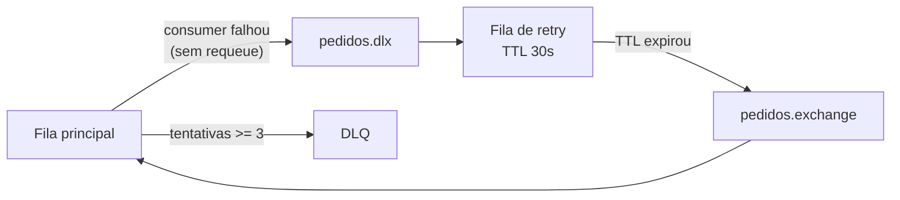
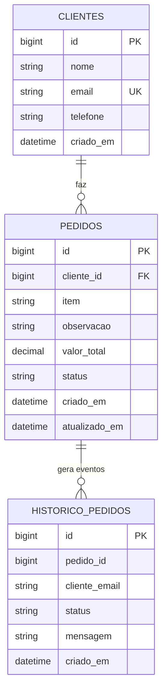

<h1 align="center">🍔 LanchaFacil</h1>

<p align="center">
  Sistema de gerenciamento de pedidos para lanchonetes com <b>mensageria assíncrona</b>:<br>
  cada mudança de status do pedido vira um evento no RabbitMQ que dispara e-mails e grava histórico.
</p>

<p align="center">
  
  
  
  
  
  
</p>

---

## 📋 Índice

- [Sobre o projeto](#-sobre-o-projeto)
- [Funcionalidades](#-funcionalidades)
- [Tecnologias](#-tecnologias)
- [Arquitetura](#-arquitetura)
- [Mensageria (RabbitMQ)](#-mensageria-rabbitmq)
- [Modelo de dados](#-modelo-de-dados)
- [Documentação da API](#-documentação-da-api)
- [Como rodar](#-como-rodar)
- [Configuração de e-mail](#-configuração-de-e-mail)
- [Testes](#-testes)
- [Estrutura de pastas](#-estrutura-de-pastas)
- [Status e próximos passos](#-status-e-próximos-passos)
- [Autor](#-autor)

---

## 📌 Sobre o projeto

O **LanchaFacil** é uma aplicação fullstack para gerenciar uma lanchonete: cadastro de clientes, registro de pedidos e acompanhamento do preparo na cozinha.

O foco do projeto é a **comunicação assíncrona entre serviços**. Sempre que um pedido é criado ou muda de status, a API publica um evento no RabbitMQ. Dois consumers independentes processam esse evento:

- um **envia um e-mail** de atualização para o cliente;
- outro **registra o evento no histórico** do pedido, no banco de dados.

Se o processamento falhar, a mensagem passa por uma fila de **retry** e, depois de esgotar as tentativas, vai para uma **Dead Letter Queue (DLQ)**.

> Projeto desenvolvido para a N2 da disciplina de Mensageria.

---

## ✨ Funcionalidades

**Clientes**
- Cadastro, listagem, consulta, atualização e remoção
- Validação de campos obrigatórios e de formato de e-mail
- E-mail único por cliente

**Pedidos**
- Criação de pedido vinculado a um cliente (item, observação e valor total)
- Fluxo de status: `RECEBIDO` → `EM_PREPARO` → `PRONTO` → `ENTREGUE` (ou `CANCELADO`)
- Painel da cozinha, que lista só os pedidos ativos (`RECEBIDO`, `EM_PREPARO` e `PRONTO`)

**Mensageria e notificações**
- Evento publicado a cada pedido criado e a cada mudança de status
- E-mail automático para o cliente com o status atualizado
- Histórico de eventos persistido no banco (os 20 mais recentes ficam disponíveis na API)
- Retry automático com TTL e DLQ para mensagens que não puderam ser processadas

**Frontend**
- Três telas: **Clientes**, **Pedidos** e **Cozinha**
- Cards de resumo (clientes, pedidos, fila da cozinha e eventos) e barra lateral com o histórico recente

---


## 🛠️ Tecnologias

### Backend

| Tecnologia | Uso |
|---|---|
| Java 17 | Linguagem |
| Spring Boot 3.3.4 | Framework base |
| Spring Web | API REST |
| Spring Data JPA (Hibernate) | Persistência |
| Spring Validation | Validação dos DTOs |
| Spring AMQP | Integração com RabbitMQ |
| Spring Mail | Envio de e-mails via SMTP |
| Lombok | Redução de boilerplate |
| PostgreSQL 16 | Banco de dados |
| H2 | Banco em memória para os testes |
| Maven (wrapper incluso) | Build |

### Frontend

| Tecnologia | Uso |
|---|---|
| React 19 | Interface |
| Vite 8 | Bundler e servidor de desenvolvimento |
| Axios | Requisições HTTP |

### Infraestrutura

| Tecnologia | Uso |
|---|---|
| Docker Compose | Sobe PostgreSQL e RabbitMQ |
| RabbitMQ 3 (management) | Broker de mensagens |
| Mailtrap / Ethereal | SMTP de teste para os e-mails |

---

## 🏗️ Arquitetura

O backend é organizado **por funcionalidade** (*package by feature*): cada pacote reúne controller, service, repository, entidade e DTOs do seu domínio.



### Responsabilidade de cada camada

| Camada | O que faz |
|---|---|
| **Controller** | Expõe os endpoints REST, valida a entrada (`@Valid`) e delega para o service |
| **Service** | Regras de negócio, transações e publicação de eventos |
| **Repository** | Acesso ao banco via Spring Data JPA |
| **Entity** | Mapeamento das tabelas (`@Entity`) |
| **Request / Response** | Records Java usados como DTOs, para não expor as entidades JPA |
| **Consumer** | Escuta filas do RabbitMQ e executa a ação (enviar e-mail, gravar histórico) |
| **`ApiExceptionHandler`** | Converte exceções em respostas JSON padronizadas (400 e 404) |

---

## 📨 Mensageria (RabbitMQ)

### Fluxo de uma atualização de status



O endpoint responde assim que o evento é publicado. O envio do e-mail e a gravação do histórico acontecem de forma assíncrona, sem travar a requisição.

### Exchanges, filas e routing keys

Existem duas exchanges do tipo *direct*: `pedidos.exchange` (principal) e `pedidos.dlx` (retry e DLQ).

| Finalidade | Routing key | Fila principal | Fila de retry | DLQ |
|---|---|---|---|---|
| Pedido criado | `pedido.criado` | `fila.pedidos` | `fila.pedidos.retry` | `fila.pedidos.dlq` |
| Notificação por e-mail | `pedido.status` | `fila.notificacao` | `fila.notificacao.retry` | `fila.notificacao.dlq` |
| Histórico | `pedido.log` | `fila.historico` | `fila.historico.retry` | `fila.historico.dlq` |

> No momento, `fila.pedidos` recebe o evento de pedido criado, mas ainda não há um consumer escutando essa fila.

### Estratégia de retry e DLQ



1. Se o consumer lançar uma exceção, a mensagem **não volta** para a fila (`default-requeue-rejected: false`). Ela é rejeitada e encaminhada para `pedidos.dlx`.
2. A DLX entrega a mensagem na **fila de retry**, onde ela espera o TTL (30 segundos por padrão).
3. Quando o TTL expira, a mensagem volta para `pedidos.exchange` e é reprocessada.
4. O `RabbitRetryService` conta as tentativas pelo header `x-death`. Ao atingir o limite (3 por padrão), o `RabbitConsumerExecutor` envia a mensagem para a **DLQ** em vez de processá-la de novo.

Esses valores são configuráveis em `application.yml`:

```yaml
app:
  rabbitmq:
    max-retries: 3        # tentativas antes de ir para a DLQ
    retry-ttl-ms: 30000   # tempo de espera na fila de retry (ms)
    reset-topology: true  # apaga e recria as filas no startup (veja o aviso abaixo)
```

> ⚠️ **`reset-topology: true` é pensado para desenvolvimento.** Com ele ligado, todas as filas do projeto são apagadas (junto com as mensagens pendentes) toda vez que o backend inicia. Em um ambiente real, mude para `false`.

---

## 🗄️ Modelo de dados



`HISTORICO_PEDIDOS.pedido_id` guarda apenas o ID do pedido, sem chave estrangeira. O histórico é gravado pelo consumer a partir do evento recebido.

**Status do pedido (`StatusPedido`):** `RECEBIDO` · `EM_PREPARO` · `PRONTO` · `ENTREGUE` · `CANCELADO`

As tabelas são criadas e atualizadas automaticamente pelo Hibernate (`ddl-auto: update`).

---

## 📖 Documentação da API

URL base: `http://localhost:8080/api`

### Clientes — `/api/clientes`

| Método | Rota | Descrição | Resposta |
|---|---|---|---|
| `GET` | `/api/clientes` | Lista todos os clientes | `200` |
| `GET` | `/api/clientes/{id}` | Busca um cliente por ID | `200` / `404` |
| `POST` | `/api/clientes` | Cadastra um cliente | `201` / `400` |
| `PUT` | `/api/clientes/{id}` | Atualiza um cliente | `200` / `400` / `404` |
| `DELETE` | `/api/clientes/{id}` | Remove um cliente | `204` / `404` |

**Exemplo de corpo (`POST` / `PUT`):**

```json
{
  "nome": "Maria Silva",
  "email": "maria@email.com",
  "telefone": "62999999999"
}
```

### Pedidos — `/api/pedidos`

| Método | Rota | Descrição | Resposta |
|---|---|---|---|
| `GET` | `/api/pedidos` | Lista todos os pedidos, do mais recente para o mais antigo | `200` |
| `GET` | `/api/pedidos/{id}` | Busca um pedido por ID | `200` / `404` |
| `GET` | `/api/pedidos/cozinha` | Pedidos ativos (`RECEBIDO`, `EM_PREPARO`, `PRONTO`), dos mais antigos para os mais novos | `200` |
| `POST` | `/api/pedidos` | Cria um pedido (status inicial `RECEBIDO`) | `201` / `400` / `404` |
| `PATCH` | `/api/pedidos/{id}/status` | Atualiza o status do pedido | `200` / `400` / `404` |

**Criar pedido (`POST`):**

```json
{
  "clienteId": 1,
  "item": "X-Burguer com batata",
  "observacao": "Sem cebola",
  "valorTotal": 32.90
}
```

A `observacao` é opcional. Se vier vazia, o sistema grava `"Sem observacoes"`. O `valorTotal` precisa ser maior que `0.01`.

**Atualizar status (`PATCH`):**

```json
{ "status": "EM_PREPARO" }
```

**Resposta de um pedido:**

```json
{
  "id": 1,
  "clienteId": 1,
  "clienteNome": "Maria Silva",
  "clienteEmail": "maria@email.com",
  "item": "X-Burguer com batata",
  "observacao": "Sem cebola",
  "valorTotal": 32.90,
  "status": "RECEBIDO",
  "criadoEm": "2026-01-10T19:30:00",
  "atualizadoEm": "2026-01-10T19:30:00"
}
```

### Histórico — `/api/historico`

| Método | Rota | Descrição | Resposta |
|---|---|---|---|
| `GET` | `/api/historico` | Os 20 eventos mais recentes processados pela fila de histórico | `200` |

### Formato dos erros

**Recurso não encontrado (`404`)** e **regra de negócio violada (`400`)**, como e-mail duplicado:

```json
{
  "timestamp": "2026-01-10T19:31:00.123",
  "status": 404,
  "message": "Cliente nao encontrado"
}
```

**Erro de validação (`400`):**

```json
{
  "timestamp": "2026-01-10T19:31:00.123",
  "status": 400,
  "message": "Erro de validacao",
  "errors": {
    "email": "Email invalido",
    "nome": "Nome e obrigatorio"
  }
}
```

---

## 🚀 Como rodar

### Pré-requisitos

- [Docker](https://www.docker.com/) e Docker Compose
- [Java 17+](https://adoptium.net/)
- [Node.js](https://nodejs.org/) **20.19+** ou **22.12+** (exigência do Vite 8)
- Uma conta gratuita no [Mailtrap](https://mailtrap.io) (ou [Ethereal](https://ethereal.email)) para testar os e-mails

### 1. Clonar o repositório

```bash
git clone https://github.com/Dioogooa/LanchaFacil.git
cd LanchaFacil
```

### 2. Subir a infraestrutura (PostgreSQL + RabbitMQ)

```bash
docker compose up -d
```

| Serviço | Endereço | Credenciais |
|---|---|---|
| PostgreSQL | `localhost:5433` (banco `lanchonete_db`) | `admin` / `admin` |
| RabbitMQ (AMQP) | `localhost:5672` | `guest` / `guest` |
| RabbitMQ (painel) | http://localhost:15672 | `guest` / `guest` |

> O `docker-compose.yml` não define volumes. Se os containers forem removidos (`docker compose down`), os dados do PostgreSQL são perdidos.

### 3. Configurar o e-mail

Siga a seção [Configuração de e-mail](#-configuração-de-e-mail).

### 4. Iniciar o backend

```bash
cd backend/lanchonete
./mvnw spring-boot:run          # Linux / macOS
mvnw.cmd spring-boot:run        # Windows
```

A API sobe em `http://localhost:8080` (altere com a variável `SERVER_PORT`).

### 5. Iniciar o frontend

Em outro terminal:

```bash
cd frontend
npm install
npm run dev
```

Acesse **http://localhost:5173**.

> O frontend aponta para `http://localhost:8080/api`, definido em `frontend/src/services/api.js`.

### 6. Testando o fluxo completo

1. Na tela **Clientes**, cadastre um cliente com um e-mail válido.
2. Na tela **Pedidos**, crie um pedido para esse cliente.
3. Na tela **Cozinha**, mude o status do pedido (`em preparo`, `pronto`...).
4. Veja o e-mail chegando na inbox do Mailtrap e o evento aparecendo em **Histórico recente**.
5. No painel do RabbitMQ (http://localhost:15672, aba **Queues**), acompanhe as filas `fila.notificacao`, `fila.historico` e as respectivas filas de retry e DLQ.

Também dá para testar só a API, sem o frontend:

```bash
curl -X POST http://localhost:8080/api/clientes \
  -H "Content-Type: application/json" \
  -d '{"nome":"Maria Silva","email":"maria@email.com","telefone":"62999999999"}'

curl -X POST http://localhost:8080/api/pedidos \
  -H "Content-Type: application/json" \
  -d '{"clienteId":1,"item":"X-Burguer","observacao":"Sem cebola","valorTotal":29.90}'

curl -X PATCH http://localhost:8080/api/pedidos/1/status \
  -H "Content-Type: application/json" \
  -d '{"status":"EM_PREPARO"}'
```

---

## 📧 Configuração de e-mail

O envio usa Spring Mail com SMTP. Há suporte a dois provedores de teste, que **não entregam e-mails reais**: eles capturam as mensagens para você visualizar.

### Opção A — Mailtrap (recomendado)

1. No [Mailtrap](https://mailtrap.io), acesse **Email Testing** → sua *Inbox* → **SMTP Settings**.
2. Copie o arquivo de exemplo:

   ```bash
   cp backend/lanchonete/src/main/resources/application-local.yml.example \
      backend/lanchonete/src/main/resources/application-local.yml
   ```

3. Edite o `application-local.yml` com o **username** e a **password** SMTP:

   ```yaml
   spring:
     mail:
       host: sandbox.smtp.mailtrap.io
       port: 2525
       username: SEU_USERNAME_SMTP
       password: SUA_SENHA_SMTP
   ```

   > ⚠️ Use o username e a senha **SMTP**, não o API Token.

O `application-local.yml` já está no `.gitignore`, então suas credenciais não vão para o repositório.

### Opção B — Variáveis de ambiente

**Linux / macOS:**

```bash
export MAIL_USERNAME="seu_user_smtp"
export MAIL_PASSWORD="sua_senha_smtp"
```

**Windows (PowerShell)**, usando o script incluso, que vale só para a sessão atual:

```powershell
.\scripts\set-mailtrap-env.ps1 -Username "seu_user_smtp" -Password "sua_senha_smtp"
```

### Opção C — Ethereal (alternativa)

Crie uma conta de teste em [ethereal.email](https://ethereal.email), defina `MAIL_USERNAME` e `MAIL_PASSWORD` com as credenciais geradas e ative o profile:

```bash
export SPRING_PROFILES_ACTIVE=ethereal
```

### Variáveis disponíveis

| Variável | Padrão | Descrição |
|---|---|---|
| `MAIL_HOST` | `sandbox.smtp.mailtrap.io` | Servidor SMTP |
| `MAIL_PORT` | `2525` | Porta SMTP |
| `MAIL_USERNAME` | — | Usuário SMTP |
| `MAIL_PASSWORD` | — | Senha SMTP |
| `APP_MAIL_PROVIDER` | `mailtrap` | Nome do provedor (aparece no corpo do e-mail) |
| `SERVER_PORT` | `8080` | Porta da API |

---

## 🧪 Testes

```bash
cd backend/lanchonete
./mvnw test
```

Os testes usam o profile de teste (`src/test/resources/application.yml`), com **H2 em memória** (modo PostgreSQL) e os listeners do RabbitMQ desativados, então não precisam do Docker rodando.

---

## 📁 Estrutura de pastas

```
LanchaFacil/
├── backend/
│   └── lanchonete/                          # Projeto Spring Boot
│       └── src/main/java/com/lanchonete/
│           ├── cliente/                     # Entidade, controller, service, repository e DTOs de clientes
│           ├── pedido/                      # Entidade, controller, service, repository, DTOs e StatusPedido
│           ├── historico/                   # Histórico de eventos (entidade, consumer, service, controller)
│           ├── notificacao/                 # Evento, producer e consumer das notificações
│           ├── email/                       # EmailService (Spring Mail)
│           ├── config/                      # RabbitMQ (filas, retry, DLQ), CORS
│           ├── common/                      # ApiExceptionHandler e exceções
│           └── LanchoneteApplication.java
├── frontend/                                # React + Vite
│   └── src/
│       ├── services/api.js                  # Cliente Axios
│       ├── App.jsx                          # Telas de Clientes, Pedidos e Cozinha
│       └── App.css
├── scripts/
│   └── set-mailtrap-env.ps1                 # Define as variáveis de e-mail (PowerShell)
└── docker-compose.yml                       # PostgreSQL + RabbitMQ
```

---

## ✅ Status e próximos passos

### Concluído

**Backend**
- [x] Entidades JPA, repositories, DTOs, services e controllers REST
- [x] CRUD de clientes e criação/consulta de pedidos
- [x] Validação de entrada e tratamento padronizado de erros da API

**Mensageria**
- [x] Producer de eventos de pedido
- [x] Consumer de notificação (e-mail)
- [x] Consumer de histórico (persistência no banco)
- [x] Fila de retry com TTL
- [x] Dead Letter Queue (DLQ)

**E-mails**
- [x] Spring Mail configurado
- [x] Suporte a Mailtrap e Ethereal

**Frontend**
- [x] React + Vite + Axios
- [x] Telas de Clientes, Pedidos e Cozinha
- [x] Histórico recente integrado à API

### Próximos passos

- [ ] Criar um consumer para `fila.pedidos` (hoje a fila recebe eventos, mas ninguém os consome)
- [ ] Implementar **idempotência** nos consumers, para evitar e-mails e registros duplicados em reentregas
- [ ] Configurar `reset-topology: false` por profile (produção)
- [ ] Mover a URL da API do frontend para uma variável de ambiente (`VITE_API_URL`)
- [ ] Restringir o CORS (hoje liberado para qualquer origem) e adicionar autenticação
- [ ] Adicionar testes de unidade e de integração (hoje existe apenas o teste `contextLoads`)
- [ ] Adicionar volume ao PostgreSQL no `docker-compose.yml` para persistir os dados
- [ ] Dockerizar o backend e o frontend

---

## 👨‍💻 Autor

**Diogo Oliveira**, estudante do 4º período na PUC Goiás.

[](https://github.com/Dioogooa)
[](https://www.linkedin.com/in/diogo-almeida-3676952b6/)
